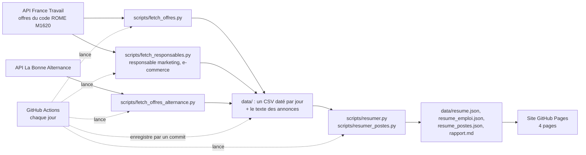

# avenir — Veille métier : marketing et e-commerce (assistant marketing M1620, responsable marketing, responsable e-commerce)

Projet de cours : veille automatisée du marché de l'emploi pour mon métier ciblé,
via l'API France Travail, enrichie de données entreprises, et restituée dans un
dashboard web qui se met à jour tout seul.

## Comment ça marche, en bref



1. **Chaque jour, GitHub lance le travail tout seul** (GitHub Actions, fichier `.github/workflows/veille.yml`), sur ses machines, ordinateur éteint. Le planning demande 7 h ; en pratique GitHub l'exécute entre 12 h et 14 h, car il retarde les tâches planifiées quand il est chargé.
2. **Les scripts interrogent les API officielles** avec des identifiants rangés dans les *secrets* du dépôt (jamais dans le code), puis écrivent un CSV daté dans `data/`.
3. **Le résultat est enregistré par un commit** signé `veille-bot` : l'historique Git est l'archive du marché, une extraction par jour depuis début octobre 2026.
4. **Le site est statique** : ses quatre pages lisent `data/resume.json` (toutes les offres), `data/resume_emploi.json` (CDI / CDD seulement), `data/resume_postes.json` (les deux postes de responsable) et `data/entreprises.csv`, et n'appellent aucun service extérieur.

| Automatique (tous les jours) | À la main |
|---|---|
| extraction France Travail (assistant marketing, responsable marketing, responsable e-commerce) et La Bonne Alternance, résumés, rapport, mise à jour du site | liste des entreprises (`scripts/entreprises.py`, lancée de temps en temps) ; `data/formation.json` (mon bilan de ce que j'ai vu en cours) ; les textes de ce README ; les contacts LinkedIn |

**Comment vérifier.** Onglet *Actions* du dépôt : une exécution verte par jour. Onglet *commits* : un commit `extraction France Travail, N offres, <date>` par jour, signé `veille-bot`.

**Vocabulaire.** *API* : interface qui permet à un programme de demander des données à un service, sans passer par son site. *Code ROME* : référentiel de France Travail qui regroupe les appellations d'un même métier (ici M1620). *Commit* : une version enregistrée des fichiers, avec un message. *Push* : envoyer ses commits vers le dépôt en ligne. *Action* : script que GitHub lance pour moi à l'heure fixée. *Secret* : valeur chiffrée par GitHub, utilisée par l'Action sans apparaître dans le code. *GitHub Pages* : l'hébergement gratuit du site à partir des fichiers du dépôt.

## 1. Métiers ciblés

**Les postes que je vise, du plus au moins intéressant pour moi :**

| Rang | Poste | Code ROME | Suivi depuis le | Vrais CDI / CDD au 14/11/2026 |
|---|---|---|---|---|
| 1 | Responsable e-commerce | E1113 | 14/11/2026 | 10 |
| 2 | Responsable marketing | M1705 (et M1716, M1718, M1711 pour les variantes digitales) | 14/11/2026 | **41** |
| 3 | Assistant / Assistante marketing (série la plus ancienne) | [M1620](https://candidat.francetravail.fr/metierscope/fiche-metier/M1620/assistant-assistante-marketing) | 22/09/2026 | 15 au titre « assistant marketing » (42 pour le code M1620 entier, dont 18 sans le mot « marketing » : agent de planning, gestionnaire de paie, assistant ADV…) |

**En vrais CDI / CDD, c'est le responsable marketing qui a le plus d'offres** (41, contre 15 et 10). Le classement ci-dessus est celui de mon intérêt, pas du volume.

Les deux postes de responsable ont été ajoutés le 14/11/2026 : j'ai donc nettement moins de données pour eux que pour l'assistant marketing, suivi depuis le 22/09. **Règle d'emploi :** pour les deux postes de responsable, seules les offres de vrais CDI et CDD sont gardées (sans alternance, stage, intérim ni annonce de formation). La série de l'assistant marketing est conservée telle quelle (toutes les offres du code M1620), avec en plus une vue « CDI / CDD seulement » sur le site, calculée depuis le 07/10/2026.

Comment les deux postes de responsable sont repérés : les offres des codes ROME voisins et les résultats d'une recherche par mots-clés (« responsable marketing », « responsable e-commerce »…), puis seules sont gardées celles dont le **titre** contient vraiment l'intitulé visé. Un titre « responsable e-commerce » peut être un poste technique ou de gestion (par exemple « Responsable Technique E-commerce »).

**Code ROME de la série principale :** M1620 (secteur Communication et marketing). Appellations proches données par Métierscope : assistant(e) de direction, planneur / planneuse stratégique, responsable marketing, chef / cheffe de produit, chargé(e) de marketing digital.

**Variantes de l'assistant marketing sur le marché** (comptées dans les 118 intitulés du 14/11/2026, toutes offres M1620) :
- Assistant / Assistante marketing — dans 64 intitulés
- Assistant(e) marketing et communication — 11
- Assistant(e) commercial(e) et marketing — 9

« Digital » n'apparaît que dans 5 intitulés : le marché dit « assistant marketing », pas « assistant marketing digital ». 26 intitulés parlent d'alternance. Je n'ai pas gardé « chef de produit » (qui ne m'intéresse pas) ni « assistant e-commerce » (2 offres seulement en CDI / CDD, mesure ponctuelle du 14/11/2026 dans l'API France Travail).

**Pourquoi l'assistant marketing :** c'est le poste de mon stage chez Mapache (assistante marketing et communication) — SEO sur Shopify, segmentation client pour newsletters, gestion de campagnes marketing, fiches produit. Le référentiel ROME confirme ce lien : le savoir-faire *"Optimiser le référencement naturel (SEO) des sites web"* et *"Mener une campagne d'e-mailing"* apparaissent explicitement dans la fiche M1620.

## 2. Questions sur ce marché

1. Combien d'offres, où (régions, villes) et avec quels contrats ?
2. Quelles compétences et quels outils reviennent le plus souvent dans les offres (SEO, CRM, Shopify, emailing...) ?
3. Quelle fourchette de salaire est proposée, et comment se compare-t-elle au salaire médian d'insertion ?
4. Comment le marché bouge-t-il, et qui recrute, y compris sans annonce ?

**Questions supplémentaires gardées** (le cours conseille de ne garder que celles qui apprennent quelque chose ; elles sont calculées par `scripts/questions.py` et affichées en bas de la page *Le métier*, avec le responsable marketing comme poste de référence puisqu'il a le plus d'offres en vrais CDI / CDD) :

5. Qu'est-ce qui change dans les outils quand on passe d'assistant à responsable marketing ?
6. S'intéresser à Paris est-il vraiment mieux pour trouver un travail ? (part des offres en Île-de-France, par zone, et salaires affichés comparés)
7. Quelles sont les missions récurrentes des trois postes ? (thèmes repérés par mots-clés dans les lignes de missions, verbes les plus fréquents)
8. Quelle expérience est demandée ? (débutant accepté, durée, poste cadre)
9. Qui recrute vraiment : type d'entreprise, secteur, entreprises qui travaillent pour des clients (agences, conseil, intérim) ou pour elles-mêmes, offres sans nom d'employeur ?

*Limites :* échantillons petits (10 offres e-commerce, 41 responsable marketing, 39 assistant marketing) ; le type d'entreprise est déduit du code d'activité (NAF) de l'annonce, inconnu pour 39 % (responsable marketing) à 69 % (assistant marketing) des offres, et la frontière « pour des clients / pour elle-même » est indicative ; les thèmes de missions sont repérés par mots-clés ; l'expérience et le secteur des offres d'assistant marketing ne sont connus que pour celles encore en ligne le 14/11, car `fetch_offres.py` ne les enregistrait pas avant (`data/enrichissement_M1620_2026-11-14.csv` les ajoute pour ce jour), et ils se complètent à chaque extraction.

## 3. Les entreprises qui recrutent le plus l'assistant marketing

**Période et méthode** (série de l'assistant marketing, M1620, toutes offres confondues). 24 extractions du 7 au 30 octobre 2026, France entière, code ROME M1620 : 252 identifiants d'offres, soit **212 annonces distinctes** une fois regroupées par entreprise, titre et lieu (une annonce republiée reçoit un nouvel identifiant). **60 annonces distinctes (28 %) n'ont aucun nom d'employeur** et ne peuvent pas être classées. Les noms sont ceux déclarés dans les annonces ; une nature n'est indiquée que lorsque j'ai lu le texte de l'annonce.

| Rang | Entreprise | Annonces distinctes | Ce que disent les annonces |
|---|---|---|---|
| 1 | ISCOD | 27 | École de formation en digital learning : elle recrute des alternants pour des entreprises partenaires (27 annonces sur 27 en alternance) |
| 2 | EFC CONSULTING | 12 | Les annonces font la promotion d'une formation à distance (« En suivant la formation Assistant Marketing à distance, vous vous formerez… ») : ce ne sont pas des offres d'emploi |
| 3 | Randstad (plusieurs entités) | 7 | Agence d'intérim : elle recrute pour le compte de ses clients |
| 4 | Aureis Formation | 5 | Annonces d'alternance, toutes issues de La Bonne Alternance |
| 5 ex æquo | SCI Pro immo, Compagnie des Alpes, Herta, TalenX | 3 chacune | voir ci-dessous |

Les entreprises du 5ᵉ rang :
- **SCI Pro immo** : employeur direct, assistant(e) marketing en CDI, à La Réunion.
- **Compagnie des Alpes** : employeur direct (domaines skiables) ; « assistant marketing & commercial » en CDD et « alternant moniteur de ski et chargé marketing/communication ».
- **Herta** : employeur direct, mais les annonces lues sont des stages de 6 mois (chef de produit marketing, community manager), classés « CDI » par France Travail.
- **TalenX** : cabinet de recrutement ; l'annonce lue n'est pas du marketing (« Responsable SAV / Gestionnaire planning »).

**Lecture.** Le haut du classement mesure surtout des intermédiaires (une école, de l'intérim) et des annonces de formation : seuls trois employeurs directs apparaissent, au 5ᵉ rang, avec trois annonces chacun. Le marché direct de cet intitulé est donc une longue traîne d'entreprises qui publient une ou deux annonces. La page *Les offres* affiche le classement du jour (dernière extraction seulement, par offre), qui n'a pas la même méthode.

**En vrais CDI / CDD seulement** (même période, 111 annonces distinctes ; 42 d'entre elles, soit 38 %, n'ont aucun nom d'employeur) : le classement est plat, personne ne dépasse 3 annonces.

| Entreprise | Annonces | Ce que disent les annonces |
|---|---|---|
| Randstad (plusieurs entités) | 3 | agence d'intérim : « assistant marketing » en CDI pour le compte de ses clients |
| SCI Pro immo | 3 | employeur direct : assistant(e) marketing en CDI, à La Réunion |
| TalenX | 3 | cabinet de recrutement ; l'annonce lue n'est pas du marketing (« Responsable SAV / Gestionnaire planning ») |
| Harry Hope, Groupe Bodemer, Les Colettes Sourcing, un groupement d'employeurs | 2 chacun | assistant marketing produit, chargé(e) de marketing opérationnel, assistant marketing technique, assistant(e) marketing (nature de ces entreprises non vérifiée) |

Pour le **responsable marketing** (un seul jour de suivi, le 14/11), aucun employeur ne publie plus de 2 offres.

**Pour les trois professionnels à trouver sur LinkedIn** : privilégier les employeurs directs ci-dessus ou les entreprises de la liste du marché caché, pas les écoles, l'intérim ni les annonces de formation.

## 4. Structure du projet

- `scripts/fetch_offres.py` — extraction France Travail (canal commun) → `data/offres_M1620_<date>.csv`
- `scripts/fetch_offres_alternance.py` — extraction La Bonne Alternance (2ᵉ canal) → `data/offres_alternance_M1620_<date>.csv`
- `scripts/textes.py` — garde le texte de chaque annonce une seule fois, dans `data/textes.jsonl`
- `scripts/fetch_responsables.py` et `scripts/postes.py` — extraction des deux postes de responsable (vrais CDI / CDD) → `data/offres_responsable-marketing_<date>.csv` et `data/offres_responsable-ecommerce_<date>.csv`
- `scripts/resumer.py` — calcule `data/resume.json` (toutes les offres M1620), `data/resume_emploi.json` (la même série en CDI / CDD seulement) et `data/rapport.md` (rapport lisible) ; `scripts/resumer_postes.py` calcule `data/resume_postes.json` (les deux postes de responsable)
- `scripts/questions.py` — calcule `data/questions.json` (outils, Paris, missions, expérience, recruteurs, pour les trois postes) ; `data/enrichissement_M1620_2026-11-14.csv` complète les offres M1620 du 14/11 avec expérience, secteur et code NAF
- `scripts/entreprises.py` — le marché caché : `data/entreprises.csv` (lancé à la main, pas chaque jour)
- `data/formation.json` — ce que le descriptif public du M2 MOD nomme (outils, unités, métiers et codes ROME visés), lu le 30/10/2026, source des tableaux « formation » du site
- Le site, servi par GitHub Pages, en quatre pages qui lisent `data/resume.json`, `data/resume_emploi.json`, `data/resume_postes.json` et `data/entreprises.csv` (un sélecteur « toutes les offres / CDI / CDD seulement » change la vue) : `metier.html` (le métier tel que le marché le nomme), `index.html` (les offres), `mouvement.html` (comment le métier bouge : courbe, offres nouvelles et disparues, outils suivis, source Apec) et `entreprises.html` (le marché caché) ; `assets/commun.css` et `assets/commun.js` partagés
- `.github/workflows/veille.yml` — GitHub Actions : chaque jour, les extractions, les résumés, puis un commit des nouvelles données

## 5. Sources de données (légales, documentées)

- **Canal commun :** [API France Travail — Offres d'emploi v2](https://francetravail.io/data/api/offres-emploi) — compte développeur sur francetravail.io. Une requête par code ROME, le total se lit dans l'en-tête `Content-Range`.
- **Postes de responsable :** même API et mêmes identifiants, recherche par codes ROME voisins et par mots-clés, puis vérification du titre et filtre « vrai emploi » (CDI ou CDD, sans alternance, stage, intérim ni annonce de formation).
- **2ᵉ canal :** [La Bonne Alternance](https://api.apprentissage.beta.gouv.fr) — offres d'alternance. Conservé et toujours collecté, mais il n'entre plus dans les chiffres du site ni dans ma recherche : je cherche un CDI ou un CDD, pas une alternance. L'API renvoie chaque offre en double ; le script dédoublonne par identifiant. Elle reprend en partie des offres France Travail (recoupement mesuré sur le site).
- **Entreprises :** [API Recherche d'entreprises (data.gouv.fr)](https://recherche-entreprises.api.gouv.fr/docs/) — gratuite, sans clé : nom, adresse du siège, activité (NAF), tranche de salariés, date de création. Elle ne fournit ni site web ni coordonnées.
- **Communes :** [geo.api.gouv.fr](https://geo.api.gouv.fr) — liste des communes de plus de 100 000 habitants, qui fixe le périmètre géographique de la liste d'entreprises.
- **Vus dans le cours, non utilisés :** base Sirene de l'INSEE en open data (exhaustivité), Pappers (dirigeants, comptes), BODACC (créations, ventes, procédures) et API Google Places (site web, téléphone). Mon périmètre (entreprises d'au moins 6 salariés, 37 départements) tient dans l'API Recherche d'entreprises ; les autres seraient utiles pour un radar de signaux ou un détecteur « on recrute ».
- Scraping LinkedIn / APEC / Indeed : **interdit**, non utilisé dans ce projet.

## 6. Le marché caché

Les sites d'offres ne montrent que les entreprises qui publient. `scripts/entreprises.py` part des entreprises elles-mêmes (c'est l'équivalent de `data/entreprises_63.csv` demandé par le cours, étendu à 37 départements dont le Puy-de-Dôme) :

- **Périmètre** : entreprises actives d'au moins 6 salariés, dont le siège est dans un département abritant une commune de plus de 100 000 habitants (37 départements).
- **Secteurs** (codes NAF) : e-commerce, numérique, édition et médias, événementiel, marques et commerce spécialisé, et agences (publicité, communication, études de marché, design).
- **Trois sections**, pour repérer d'un coup d'œil ce qui m'intéresse le plus : *cibles principales* ; *agences* (récoltées mais séparées) ; *villes du nord* (plus hautes que Paris, hors Île-de-France : Lille, Reims, Le Havre, Rouen, Amiens, Metz, Caen), tous types confondus.
- **Région** : la page permet de filtrer par région, mais la liste ne couvre que les départements qui abritent une commune de plus de 100 000 habitants : une région n'est couverte qu'en partie (le menu indique, par exemple, 5 départements sur 12 pour Auvergne-Rhône-Alpes, 4 sur 8 pour l'Île-de-France, 4 sur 13 pour l'Occitanie).
- **Résultat pour le Puy-de-Dôme (63)** : 152 entreprises, dont 65 à Clermont-Ferrand, 18 à Aubière et 10 à Cournon-d'Auvergne (numérique 61, marques et commerce spécialisé 38, agences 21, édition et médias 15, e-commerce 11, événementiel 6).
- **Pourquoi ces secteurs** : ce sont ceux où l'on trouve un poste de marketing digital ou d'e-commerce dans la formation et dans mes stages (boutique en ligne, agence, média, éditeur de logiciels). Ils ne couvrent pas l'industrie, qui est pourtant le type d'employeur le plus fréquent des offres de responsable marketing (6 des 25 offres dont le secteur est connu) : la liste du marché caché est donc biaisée vers le numérique et le commerce.
- **Ce que le fichier ne contient pas, volontairement** : les dirigeants (données publiques, mais ce dépôt est public) et le site web (l'API ne le fournit pas).
- **Limites** : le code NAF donne le secteur de l'entreprise, pas l'existence d'un poste marketing ; seul le siège est retenu (une entreprise dont le siège est ailleurs mais qui a un établissement local n'apparaît pas) ; l'API ne donne pas le site web.

**Professionnels repérés à la main sur LinkedIn** (trois profils publics lus sur LinkedIn, repérés le 14/11/2026, sans scraping, sans nom ni donnée personnelle dans ce dépôt) :

| Poste affiché | Entreprise | Ville |
|---|---|---|
| Responsable marketing | Ateya Vacances (tourisme) | Marseille et périphérie |
| Responsable marketing | The Ordinary (d'après la bannière du profil ; l'en-tête n'affiche pas d'entreprise) | Paris, Île-de-France |
| Responsable marketing digital | Brioche Dorée (restauration) | Rennes et périphérie |

Ils illustrent le poste que je vise dans des secteurs et des villes très différents ; ils servent à comprendre le métier, pas à constituer un fichier de contacts (voir la section RGPD).

## 7. Configuration et lancement

1. Créer un compte sur https://francetravail.io et s'abonner à l'API « Offres d'emploi v2 » ; créer une clé sur api.apprentissage.beta.gouv.fr
2. Copier `.env.example` vers `.env` et renseigner les identifiants (jamais commités — voir `.gitignore`). Sur GitHub, les mêmes valeurs sont des *secrets* du dépôt (Settings → Secrets and variables → Actions).

```bash
pip install -r requirements.txt
python scripts/fetch_offres.py
python scripts/fetch_offres_alternance.py
python scripts/resumer.py
python scripts/entreprises.py      # le marché caché, à relancer de temps en temps
python3 -m http.server             # pour voir le site en local
```

## 8. RGPD

- Les dirigeants d'entreprise sont des données publiques ; un contact nominatif de salarié (e-mail, téléphone) est une donnée personnelle.
- Ce dépôt est public : `data/entreprises.csv` ne contient **que des données d'entreprises, aucun nom de personne**.
- Si un contact est cherché plus tard, ce sera pour une entreprise précise, en lien avec la **fonction** de la personne (responsable marketing, RH…), pour une **finalité claire** : une candidature. La personne garde un droit d'opposition (la CNIL admet la prospection B2B à ces conditions).
- Jamais de fichier constitué pour être revendu ; jamais de contact hors de sa fonction ; aucune donnée de ce type n'est versionnée dans ce dépôt.
