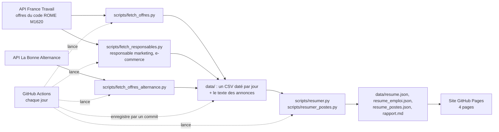

# avenir — Veille métier : marketing et e-commerce (assistant marketing M1620, responsable marketing, responsable e-commerce)

Projet de cours : veille automatisée du marché de l'emploi pour mon métier ciblé,
via l'API France Travail, enrichie de données entreprises, et restituée dans un
dashboard web qui se met à jour tout seul.

## Comment ça marche, en bref



1. **Chaque jour, GitHub lance le travail tout seul** (GitHub Actions, fichier `.github/workflows/veille.yml`), sur ses machines, ordinateur éteint. Le planning demande 7 h (`cron: "0 6 * * *"`, 6 h UTC), mais en pratique GitHub l'exécute entre 11 h et 16 h, heure de Paris (le plus souvent entre 12 h et 15 h). Ce retard vient de GitHub : il ne garantit pas l'heure des tâches planifiées et les retarde quand il est chargé, surtout pile au début d'une heure, qui est justement l'heure que j'avais demandée. Sur les exécutions de la veille, l'API de GitHub montre que la tâche planifiée est créée à 12 h 42 (14/11) et 13 h 38 (13/11) UTC, puis qu'elle ne dure que 20 à 45 secondes : le retard précède donc l'exécution et ne vient pas du script. Cela ne change rien à la série : il y a une extraction par jour, à une heure comparable (une demi-journée d'écart au plus), et la date du fichier est celle du jour d'extraction. Pour réduire le retard, on pourrait choisir une minute creuse (par exemple `17 5 * * *`), sans garantie ; je ne l'ai pas fait pour ne pas décaler la série en cours.
2. **Les scripts interrogent les API officielles** avec des identifiants rangés dans les *secrets* du dépôt (jamais dans le code), puis écrivent un CSV daté dans `data/`.
3. **Le résultat est enregistré par un commit** signé `veille-bot` : l'historique Git est l'archive du marché, une extraction par jour depuis début octobre 2026.
4. **Pas de serveur ni de base de données** : la donnée est petite (quelques centaines d'offres par jour), donc des fichiers CSV et JSON versionnés avec le code suffisent, et le site n'a rien à héberger à part ces fichiers. Si l'outil devait grossir, une vraie base (SQLite, Supabase ou Turso, vus en cours) deviendrait utile ; ce n'est pas le cas ici.
4. **Le site est statique** : ses quatre pages lisent `data/resume.json` (toutes les offres), `data/resume_emploi.json` (CDI / CDD seulement), `data/resume_postes.json` (les deux postes de responsable) et `data/entreprises.csv`, et n'appellent aucun service extérieur.

| Automatique (tous les jours) | À la main |
|---|---|
| extraction France Travail (assistant marketing, responsable marketing, responsable e-commerce) et La Bonne Alternance, résumés, rapport, mise à jour du site | liste des entreprises (`scripts/entreprises.py`, lancée de temps en temps) ; `data/formation.json` (mon bilan de ce que j'ai vu en cours) ; les textes de ce README ; les contacts LinkedIn |

**Comment vérifier.** Onglet *Actions* du dépôt : une exécution verte par jour. Onglet *commits* : un commit `extraction France Travail, N offres, <date>` par jour, signé `veille-bot`.

**Vocabulaire.** *API* : interface qui permet à un programme de demander des données à un service, sans passer par son site. *Code ROME* : référentiel de France Travail qui regroupe les appellations d'un même métier (ici M1620). *Commit* : une version enregistrée des fichiers, avec un message. *Push* : envoyer ses commits vers le dépôt en ligne. *Action* : script que GitHub lance pour moi à l'heure fixée. *Secret* : valeur chiffrée par GitHub, utilisée par l'Action sans apparaître dans le code. *GitHub Pages* : l'hébergement gratuit du site à partir des fichiers du dépôt.

## 1. Métiers ciblés

**Une progression en deux niveaux.** Je vise d'abord l'assistant marketing, qui correspond à mon stage chez Mapache. Responsable marketing et responsable e-commerce sont les postes que je vise à terme ; le responsable e-commerce a été ajouté après avoir commencé mon stage chez Monbento, qui m'a donné de nouvelles idées d'intitulés, d'où un suivi plus récent pour les deux postes de responsable.

| Niveau | Poste | Code ROME ou repérage | Suivi depuis le | Offres CDI / CDD vues depuis le début | Actives au 18/11/2026 |
|---|---|---|---|---|---|
| 1 | Assistant marketing (et variantes) | [M1620](https://candidat.francetravail.fr/metierscope/fiche-metier/M1620/assistant-assistante-marketing) | 07/10/2026 (22/09 pour toutes les offres) | 49 | 12 |
| 2 | Responsable marketing | M1705 (et M1716, M1718, M1711 pour les variantes digitales) | 14/11/2026 | 52 | **43** |
| 2 | Responsable e-commerce | E1113 | 14/11/2026 | 13 | 12 |

**Ce que montre le passage de l'assistant au responsable** (page *Le métier*) : le niveau monte. Aucune annonce d'assistant n'est cadre (le responsable marketing : 33 %), le salaire médian affiché passe de 2184 € à 3646 € bruts par mois, et le management est cité dans 14 % des annonces d'assistant contre 60 % de celles de responsable marketing.

Les deux postes de responsable ont été ajoutés le 14/11/2026 : j'ai donc nettement moins de recul pour eux (5 extractions au 18/11) que pour l'assistant marketing, suivi depuis le début (43 extractions). **Règle d'emploi :** pour les trois postes, seules les offres de vrais CDI et CDD sont gardées (sans alternance, stage, intérim ni annonce de formation) ; une offre est comptée une fois, même si elle reste en ligne plusieurs jours. Au 18/11, c'est le responsable marketing qui a le plus d'offres actives (43, contre 12 pour l'assistant et 12 pour le responsable e-commerce).

Comment les deux postes de responsable sont repérés : les offres des codes ROME voisins et les résultats d'une recherche par mots-clés (« responsable marketing », « responsable e-commerce »…), puis seules sont gardées celles dont le **titre** contient vraiment l'intitulé visé. Un titre « responsable e-commerce » peut être un poste technique ou de gestion (par exemple « Responsable Technique E-commerce »).

**Code ROME de la série principale :** M1620 (secteur Communication et marketing). Appellations proches données par Métierscope : assistant(e) de direction, planneur / planneuse stratégique, responsable marketing, chef / cheffe de produit, chargé(e) de marketing digital.

**Un même poste sous plusieurs intitulés.** Le marché donne plusieurs noms au poste d'assistant marketing. J'ai comparé les missions, le niveau et le salaire de chaque intitulé : les trois premiers (assistant marketing et communication, assistant commercial(e) et marketing, assistant web ou digital marketing) sont proches de l'assistant marketing (mêmes missions, aucun poste cadre, salaires voisins). Je les regroupe donc en un seul poste. Annonces distinctes en CDI / CDD depuis le 07/10/2026 (un titre peut compter dans plusieurs lignes ; 48 annonces au total) :
- Assistant(e) marketing — 39
- Assistant(e) commercial(e) et marketing — 11
- Assistant(e) marketing et communication — 8
- Assistant(e) web ou digital marketing — 3

« Chargé(e) de marketing » (une dizaine d'annonces) est un cran au-dessus de l'assistant ; je ne l'ai pas gardé comme poste, car l'échantillon est trop petit pour une comparaison. « Adjoint(e) à la direction marketing » (4 annonces) ressemble davantage à un poste de responsable, mais l'échantillon est trop petit : je le surveille sans le compter. « Digital » n'apparaît que dans quelques intitulés : le marché dit « assistant marketing », pas « assistant marketing digital ». Je n'ai pas gardé « chef de produit » (qui ne m'intéresse pas) ni « assistant e-commerce » (2 offres seulement en CDI / CDD).

**Pourquoi l'assistant marketing :** c'est le poste de mon stage chez Mapache (assistante marketing et communication) — SEO sur Shopify, segmentation client pour newsletters, gestion de campagnes marketing, fiches produit. Le référentiel ROME confirme ce lien : le savoir-faire *"Optimiser le référencement naturel (SEO) des sites web"* et *"Mener une campagne d'e-mailing"* apparaissent explicitement dans la fiche M1620.

## 2. Questions sur ce marché

1. Combien d'offres, où (régions, villes) et avec quels contrats ?
2. Quelles compétences et quels outils reviennent le plus souvent dans les offres (SEO, CRM, Shopify, emailing...) ?
3. Quelle fourchette de salaire est proposée, et comment se compare-t-elle au salaire médian d'insertion ?
4. Comment le marché bouge-t-il, et qui recrute, y compris sans annonce ?

**Questions supplémentaires gardées** (le cours conseille de ne garder que celles qui apprennent quelque chose ; elles sont calculées par `scripts/questions.py` et affichées en bas de la page *Le métier*, avec le responsable marketing comme poste de référence puisqu'il a le plus d'offres en vrais CDI / CDD) :

5. Qu'est-ce qui change dans les outils quand on passe d'assistant à responsable marketing ?
6. S'intéresser à Paris est-il vraiment mieux pour trouver un travail ? (part des offres en Île-de-France, par zone, et salaires affichés comparés)
7. Quelles sont les missions récurrentes des trois postes ? (thèmes repérés par mots-clés dans les lignes de missions, verbes les plus fréquents)
8. Quelle expérience est demandée ? (débutant accepté, durée, poste cadre)
9. Qui recrute vraiment : type d'entreprise, secteur, entreprises qui travaillent pour des clients (agences, conseil, intérim) ou pour elles-mêmes, offres sans nom d'employeur ? *(analyse calculée dans `data/questions.json`, non affichée sur le site pour alléger la page ; le marché caché montre les secteurs des entreprises)*

*Limites :* échantillons petits (10 offres e-commerce, 41 responsable marketing, 39 assistant marketing) ; le type d'entreprise est déduit du code d'activité (NAF) de l'annonce, inconnu pour 39 % (responsable marketing) à 69 % (assistant marketing) des offres, et la frontière « pour des clients / pour elle-même » est indicative ; les thèmes de missions sont repérés par mots-clés ; l'expérience et le secteur des offres d'assistant marketing ne sont connus que pour celles encore en ligne le 14/11, car `fetch_offres.py` ne les enregistrait pas avant (`data/enrichissement_M1620_2026-11-14.csv` les ajoute pour ce jour), et ils se complètent à chaque extraction.

## 3. Les entreprises qui recrutent le plus l'assistant marketing

**Période et méthode** (série de l'assistant marketing, M1620, toutes offres confondues). 24 extractions du 7 au 30 octobre 2026, France entière, code ROME M1620 : 252 identifiants d'offres, soit **212 annonces distinctes** une fois regroupées par entreprise, titre et lieu (une annonce republiée reçoit un nouvel identifiant). **60 annonces distinctes (28 %) n'ont aucun nom d'employeur** et ne peuvent pas être classées. Les noms sont ceux déclarés dans les annonces ; une nature n'est indiquée que lorsque j'ai lu le texte de l'annonce.

| Rang | Entreprise | Annonces distinctes | Ce que disent les annonces |
|---|---|---|---|
| 1 | ISCOD | 27 | École de formation en digital learning : elle recrute des alternants pour des entreprises partenaires (27 annonces sur 27 en alternance) |
| 2 | EFC CONSULTING | 12 | Les annonces font la promotion d'une formation à distance (« En suivant la formation Assistant Marketing à distance, vous vous formerez… ») : ce ne sont pas des offres d'emploi |
| 3 | Randstad (plusieurs entités) | 7 | Agence d'intérim : elle recrute pour le compte de ses clients |
| 4 | Aureis Formation | 5 | Annonces d'alternance, toutes issues de La Bonne Alternance |
| 5 ex æquo | SCI Pro immo, Compagnie des Alpes, Herta, TalenX | 3 chacune | voir ci-dessous |

Les entreprises du 5ᵉ rang :
- **SCI Pro immo** : employeur direct, assistant(e) marketing en CDI, à La Réunion.
- **Compagnie des Alpes** : employeur direct (domaines skiables) ; « assistant marketing & commercial » en CDD et « alternant moniteur de ski et chargé marketing/communication ».
- **Herta** : employeur direct, mais les annonces lues sont des stages de 6 mois (chef de produit marketing, community manager), classés « CDI » par France Travail.
- **TalenX** : cabinet de recrutement ; l'annonce lue n'est pas du marketing (« Responsable SAV / Gestionnaire planning »).

**Lecture.** Le haut du classement mesure surtout des intermédiaires (une école, de l'intérim) et des annonces de formation : seuls trois employeurs directs apparaissent, au 5ᵉ rang, avec trois annonces chacun. Le marché direct de cet intitulé est donc une longue traîne d'entreprises qui publient une ou deux annonces. La page *Les offres* affiche le classement du jour (dernière extraction seulement, par offre), qui n'a pas la même méthode.

**En vrais CDI / CDD seulement** (même période, 111 annonces distinctes ; 42 d'entre elles, soit 38 %, n'ont aucun nom d'employeur) : le classement est plat, personne ne dépasse 3 annonces.

| Entreprise | Annonces | Ce que disent les annonces |
|---|---|---|
| Randstad (plusieurs entités) | 3 | agence d'intérim : « assistant marketing » en CDI pour le compte de ses clients |
| SCI Pro immo | 3 | employeur direct : assistant(e) marketing en CDI, à La Réunion |
| TalenX | 3 | cabinet de recrutement ; l'annonce lue n'est pas du marketing (« Responsable SAV / Gestionnaire planning ») |
| Harry Hope, Groupe Bodemer, Les Colettes Sourcing, un groupement d'employeurs | 2 chacun | assistant marketing produit, chargé(e) de marketing opérationnel, assistant marketing technique, assistant(e) marketing (nature de ces entreprises non vérifiée) |

Pour le **responsable marketing** (un seul jour de suivi, le 14/11), aucun employeur ne publie plus de 2 offres.

**Pour les trois professionnels à trouver sur LinkedIn** : privilégier les employeurs directs ci-dessus ou les entreprises de la liste du marché caché, pas les écoles, l'intérim ni les annonces de formation.

## 4. Structure du projet

- `scripts/fetch_offres.py` — extraction France Travail (canal commun) → `data/offres_M1620_<date>.csv`
- `scripts/fetch_offres_alternance.py` — extraction La Bonne Alternance (2ᵉ canal) → `data/offres_alternance_M1620_<date>.csv`
- `scripts/textes.py` — garde le texte de chaque annonce une seule fois, dans `data/textes.jsonl`
- `scripts/fetch_responsables.py` et `scripts/postes.py` — extraction des deux postes de responsable (vrais CDI / CDD) → `data/offres_responsable-marketing_<date>.csv` et `data/offres_responsable-ecommerce_<date>.csv`
- `scripts/resumer.py` — calcule `data/resume.json` (toutes les offres M1620), `data/resume_emploi.json` (la même série en CDI / CDD seulement) et `data/rapport.md` (rapport lisible) ; `scripts/resumer_postes.py` calcule `data/resume_postes.json` (les deux postes de responsable)
- `scripts/questions.py` — calcule `data/questions.json` (outils, Paris, missions, expérience, recruteurs, pour les trois postes) ; `data/enrichissement_M1620_2026-11-14.csv` complète les offres M1620 du 14/11 avec expérience, secteur et code NAF
- `scripts/carte.py` — recoupe `data/entreprises.csv` et les offres des trois postes par département → `data/carte.json` ; `assets/departements.geojson` donne les contours (version simplifiée des départements, données publiques)
- `scripts/entreprises.py` — le marché caché : `data/entreprises.csv` (lancé à la main, pas chaque jour)
- `data/formation.json` — ce que le descriptif public du M2 MOD nomme (outils, unités, métiers et codes ROME visés), lu le 30/10/2026, source des tableaux « formation » du site
- Le site, servi par GitHub Pages, en huit pages à dérouler dans l'ordre de l'oral (chaque page se termine par un bouton « Suite ») : `index.html` (accueil : l'objectif, la démarche en six étapes, les trois intitulés), `metier.html` (1. le métier choisi : de l'assistant au responsable, les intitulés, les questions et leurs réponses), `methode.html` (2. comment j'ai fait : la chaîne en cinq maillons, l'aspect légal), `offres.html` et `mouvement.html` (3. ce qui en ressort : contrats, départements, salaires, outils cités ; puis comment le métier bouge : offres nouvelles et disparues, évolution des outils, source Apec), `entreprises.html` (4. le marché caché : la carte territoire × secteur et la liste), `formation.html` (5. ma formation : les métiers visés par le M2, ce que j'ai vu et ce qu'il me manque) et `actions.html` (6. conclusion : ma position et mes prochaines actions). Elles lisent `data/resume.json`, `data/resume_emploi.json`, `data/resume_postes.json`, `data/questions.json`, `data/carte.json`, `data/formation.json` et `data/entreprises.csv`.  Les pages Les offres et Comment ça bouge ne montrent que les vrais CDI et CDD (sans alternance, stage, intérim ni annonce de formation) ; les fichiers « toutes les offres » restent produits chaque jour dans `data/`. `assets/commun.css` contient la palette (Oat Silk, Mulberry Kiss, Blue Reverie, Midnight Custard ; les couleurs se changent en modifiant les variables en tête de ce fichier) et les polices : les titres sont en Gloock (licence SIL Open Font, fichiers hébergés dans `assets/fonts`, donc aucun appel à un service extérieur comme Google Fonts) ; `assets/commun.js` contient la navigation.
- `.github/workflows/veille.yml` — GitHub Actions : chaque jour, les extractions, les résumés, puis un commit des nouvelles données

## 5. Sources de données (légales, documentées)

- **Canal commun :** [API France Travail — Offres d'emploi v2](https://francetravail.io/data/api/offres-emploi) — compte développeur sur francetravail.io. Une requête par code ROME, le total se lit dans l'en-tête `Content-Range`.
- **Postes de responsable :** même API et mêmes identifiants, recherche par codes ROME voisins et par mots-clés, puis vérification du titre et filtre « vrai emploi » (CDI ou CDD, sans alternance, stage, intérim ni annonce de formation).
- **2ᵉ canal :** [La Bonne Alternance](https://api.apprentissage.beta.gouv.fr) — offres d'alternance. Conservé et toujours collecté, mais il n'entre plus dans les chiffres du site ni dans ma recherche : je cherche un CDI ou un CDD, pas une alternance. L'API renvoie chaque offre en double ; le script dédoublonne par identifiant. Elle reprend en partie des offres France Travail (recoupement mesuré sur le site).
- **Entreprises :** [API Recherche d'entreprises (data.gouv.fr)](https://recherche-entreprises.api.gouv.fr/docs/) — gratuite, sans clé : nom, adresse du siège, activité (NAF), tranche de salariés, date de création. Elle ne fournit ni site web ni coordonnées.
- **Communes :** [geo.api.gouv.fr](https://geo.api.gouv.fr) — liste des communes de plus de 100 000 habitants, qui fixe le périmètre géographique de la liste d'entreprises.
- **Vus dans le cours, non utilisés :** base Sirene de l'INSEE en open data (exhaustivité), Pappers (dirigeants, comptes), BODACC (créations, ventes, procédures) et API Google Places (site web, téléphone). Mon périmètre (entreprises d'au moins 6 salariés, 37 départements) tient dans l'API Recherche d'entreprises ; les autres seraient utiles pour un radar de signaux ou un détecteur « on recrute ».
- Scraping LinkedIn / APEC / Indeed : **interdit**, non utilisé dans ce projet.

## 6. Le marché caché

Les sites d'offres ne montrent que les entreprises qui publient. `scripts/entreprises.py` part des entreprises elles-mêmes (c'est l'équivalent de `data/entreprises_63.csv` demandé par le cours, étendu à 37 départements dont le Puy-de-Dôme) :

- **Périmètre** : entreprises actives d'au moins 6 salariés (20 pour l'industrie), dont le siège est dans un département abritant une commune de plus de 100 000 habitants (37 départements).
- **Secteurs** (codes NAF) : e-commerce, numérique, édition et médias, événementiel, marques et commerce spécialisé, et agences (publicité, communication, études de marché, design).
- **Quatre sections**, pour repérer d'un coup d'œil ce qui m'intéresse le plus : *cibles principales* ; *industrie* (ajoutée le 14/11/2026, voir ci-dessous) ; *agences* (récoltées mais séparées) ; *villes du nord* (plus hautes que Paris, hors Île-de-France : Lille, Reims, Le Havre, Rouen, Amiens, Metz, Caen), tous types confondus.
- **Région** : la page permet de filtrer par région, mais la liste ne couvre que les départements qui abritent une commune de plus de 100 000 habitants : une région n'est couverte qu'en partie (le menu indique, par exemple, 5 départements sur 12 pour Auvergne-Rhône-Alpes, 4 sur 8 pour l'Île-de-France, 4 sur 13 pour l'Occitanie).
- **Résultat pour le Puy-de-Dôme (63)** : 348 entreprises, dont 86 à Clermont-Ferrand, 21 à Aubière, 21 à Cournon-d'Auvergne et 19 à Thiers (industrie 196, numérique 61, marques et commerce spécialisé 38, agences 21, édition et médias 15, e-commerce 11, événementiel 6). Au total, la liste compte 29 080 entreprises.
- **Pourquoi ces secteurs** : au départ, j'avais choisi ceux où l'on trouve un poste de marketing digital ou d'e-commerce d'après mon stage et la formation (boutique en ligne, agence, média, éditeur de logiciels). Ce choix partait de l'intitulé que je visais, pas des offres. Les offres de responsable marketing lues le 14/11 ont montré que l'industrie est le premier type d'employeur (6 des 25 offres dont le secteur est connu : alimentaire, chimie, pharmacie, électronique, machines, meubles). J'ai donc ajouté toute l'industrie manufacturière (section C de la NAF) à partir de 20 salariés, car 11 des 12 établissements de ces offres dont la taille est connue ont 20 salariés ou plus. **Le secteur d'activité compte donc dans la recherche : chercher seulement là où le titre « marketing digital » est évident fait manquer une grande partie des employeurs.** Le fichier est passé de 18 395 à 29 080 entreprises (8 Mo).
- **Ce que le fichier ne contient pas, volontairement** : les dirigeants (données publiques, mais ce dépôt est public) et le site web (l'API ne le fournit pas).
- **Ma mission : la carte territoire × secteur** (choisie le 15/11/2026 parmi les pistes du cours : détecteur « on recrute », bon contact, score de maturité digitale, radar de signaux, carte). But : repérer où se concentrent les entreprises susceptibles d'embaucher un profil marketing, par secteur, et le comparer aux offres réellement publiées. Où il y a beaucoup d'entreprises et peu d'offres, le marché caché pèse le plus, et c'est là qu'une candidature spontanée a le plus de sens. Pourquoi celle-là : elle répond à ma question « Paris est-il vraiment mieux ? », elle n'utilise que des données d'entreprises (aucune donnée personnelle) et elle se fait avec la liste que j'ai déjà. La démarche suit celle du cours : une API (Recherche d'entreprises), une base (`data/entreprises.csv`), un recoupement (avec les offres des trois postes, `scripts/carte.py` → `data/carte.json`), une décision (où chercher en priorité). Elle est affichée en haut de la page *Le marché caché* (carte de France par département, secteur au choix, ronds bleus = offres).
- **Ce que la carte montre aujourd'hui** (17/11/2026) : les cinq départements les plus riches en entreprises (Paris, Hauts-de-Seine, Rhône, Nord, Bouches-du-Rhône) regroupent 47 % des entreprises recensées et 48 % des offres publiées dans les départements couverts : les offres suivent les entreprises, il n'y a pas de grande zone riche en entreprises mais vide d'offres. En revanche, 36 des 113 offres localisées sont dans des départements que la liste d'entreprises ne couvre pas, ce qui est une limite de la liste, pas du marché.
- **Limites** : le code NAF donne le secteur de l'entreprise, pas l'existence d'un poste marketing ; seul le siège est retenu (une entreprise dont le siège est ailleurs mais qui a un établissement local n'apparaît pas) ; l'API ne donne pas le site web.

**Professionnels repérés à la main sur LinkedIn** (trois profils publics lus sur LinkedIn, repérés le 14/11/2026, sans scraping, sans nom ni donnée personnelle dans ce dépôt) :

| Poste affiché | Entreprise | Ville |
|---|---|---|
| Responsable marketing | Ateya Vacances (tourisme) | Marseille et périphérie |
| Responsable marketing | The Ordinary (d'après la bannière du profil ; l'en-tête n'affiche pas d'entreprise) | Paris, Île-de-France |
| Responsable marketing digital | Brioche Dorée (restauration) | Rennes et périphérie |

Ils illustrent le poste que je vise dans des secteurs et des villes très différents ; ils servent à comprendre le métier, pas à constituer un fichier de contacts (voir la section RGPD).

## 7. Configuration et lancement

1. Créer un compte sur https://francetravail.io et s'abonner à l'API « Offres d'emploi v2 » ; créer une clé sur api.apprentissage.beta.gouv.fr
2. Copier `.env.example` vers `.env` et renseigner les identifiants (jamais commités — voir `.gitignore`). Sur GitHub, les mêmes valeurs sont des *secrets* du dépôt (Settings → Secrets and variables → Actions).

```bash
pip install -r requirements.txt
python scripts/fetch_offres.py
python scripts/fetch_offres_alternance.py
python scripts/resumer.py
python scripts/entreprises.py      # le marché caché, à relancer de temps en temps
python3 -m http.server             # pour voir le site en local
```

## 8. RGPD

- Les dirigeants d'entreprise sont des données publiques ; un contact nominatif de salarié (e-mail, téléphone) est une donnée personnelle.
- Ce dépôt est public : `data/entreprises.csv` ne contient **que des données d'entreprises, aucun nom de personne**.
- Si un contact est cherché plus tard, ce sera pour une entreprise précise, en lien avec la **fonction** de la personne (responsable marketing, RH…), pour une **finalité claire** : une candidature. La personne garde un droit d'opposition (la CNIL admet la prospection B2B à ces conditions).
- Jamais de fichier constitué pour être revendu ; jamais de contact hors de sa fonction ; aucune donnée de ce type n'est versionnée dans ce dépôt.

## 9. Ce que je ferai ensuite (actions à mener)

Ces actions sont **prévues, pas encore réalisées** : le projet s'arrête au rendu du 19/11/2026. Les échéances sont indicatives et chaque action s'appuie sur un chiffre du site.

| Action | Échéance indicative | Pourquoi (chiffre du site) |
|---|---|---|
| **Entretenir mon profil LinkedIn en continu** : le mettre à jour avec mes stages (Monbento, Mapache) et le vocabulaire récurrent des offres, publier régulièrement (résultats de ce projet, retours de stage, formations suivies) | dès décembre 2026, puis chaque mois | LinkedIn est cité dans 22 % des offres de responsable marketing contre 5 % pour l'assistant ; mon bilan d'outils dit « théorie seulement » |
| **Trois formations au maximum**, parmi celles qui comblent un écart mesuré : emailing (gratuit : HubSpot Academy ou Brevo), Adobe (certification payante ou accès via mon établissement), CRM (HubSpot, gratuit) ou analyse web (Google Analytics, gratuit) | à choisir, d'ici fin janvier 2027 | l'emailing est l'outil le plus cité des offres d'assistant (44 %) ; Adobe l'est dans 21 % des offres d'assistant et 14 % de celles de responsable ; l'analyse et le reporting sont la mission la plus citée du responsable marketing (79 %) ; aucun CRM ne domine (HubSpot, Salesforce, Pipedrive cités une à quatre fois), donc apprendre la logique d'un CRM plutôt qu'un logiciel |
| **Lettre de motivation adaptée à chaque offre**, en semi-automatique : un script repère les missions et outils d'une annonce (le dépôt garde déjà le texte de chaque annonce) et propose un brouillon à partir de mes expériences, que je relis et corrige toujours avant envoi ; mes expériences restent dans un fichier hors du dépôt public | à étudier début 2027 | adapter la candidature à l'annonce, sans envoi automatique |
| **Candidatures spontanées ciblées** dans le marché caché, choisies avec la carte territoire × secteur, adressées à une fonction (responsable marketing, RH) et jamais à une personne hors de sa fonction | à partir de décembre 2026 | 36 des 113 offres localisées sont hors des départements couverts, et l'industrie est le premier employeur du responsable marketing dans les offres lues |
| **Relire la veille une fois par mois** (page *Comment il bouge*) et mettre à jour mon bilan d'outils (`data/formation.json`) | chaque mois dès décembre 2026 | la série quotidienne ne vaut que si on la relit |

## 10. Conclusion et position

*(Chiffres au 18/11/2026 ; la même conclusion est sur la page « Conclusion » du site, où les chiffres se mettent à jour.)*

**Ma position.** Je vise d'abord un poste d'assistant marketing en CDI ou CDD, sous ses différents intitulés, avec pour finalité un poste à responsabilité : responsable e-commerce ou responsable marketing. Au vu de mon parcours professionnel (deux stages), il me paraît cohérent de ne pas viser tout de suite un poste de responsable. Les offres le confirment : 15 % des annonces de responsable e-commerce et 31 % de celles de responsable marketing acceptent un débutant, contre 39 % pour l'assistant ; 33 % des annonces de responsable marketing sont des postes cadres, contre 0 % pour l'assistant. Le salaire affiché suit la même pente : environ 2184 € bruts par mois pour l'assistant, 3646 € pour le responsable marketing.

**Où chercher.** Pas seulement à Paris : l'Île-de-France ne regroupe que 22 % des offres d'assistant et 35 % de celles de responsable marketing. Pas seulement dans le numérique et les agences : « Industrie » est le type d'employeur le plus fréquent du responsable marketing (7 offres). Et pas seulement dans les annonces : la carte du marché caché indique où envoyer des candidatures spontanées.

**Ce que je dois acquérir.** Les outils de pilotage qui montent avec le poste : LinkedIn (6 % des annonces d'assistant, 23 % de celles de responsable marketing), un CRM (10 % puis 31 %), ainsi que l'emailing et Adobe, que j'ai repérés comme écarts (voir la section 9).

**Ce que ces chiffres ne disent pas.** Peu d'offres actives : 12 pour l'assistant, 43 pour le responsable marketing, 12 pour le responsable e-commerce. Des suivis de longueurs différentes : 43 extractions pour l'assistant, 5 pour les responsables. Un salaire affiché dans une minorité d'annonces. Ce sont des tendances, pas des vérités.
